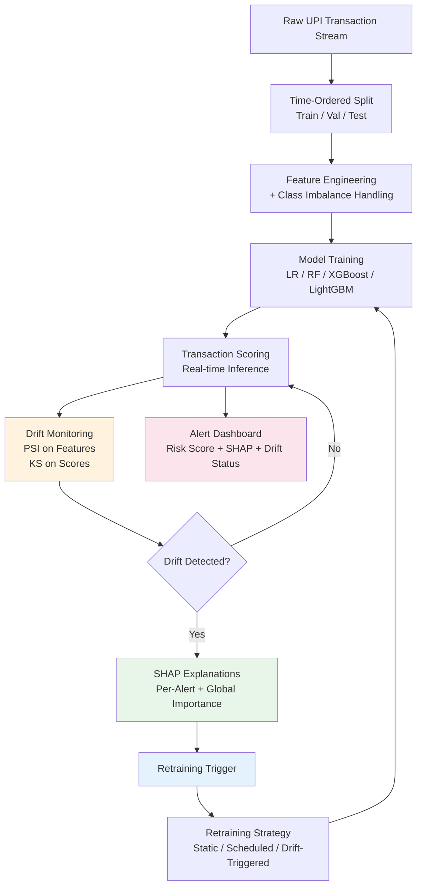

# UPI Fraud Detection — Presentation & Project Plan

**Project**: A Drift-Aware and Explainable Machine Learning Framework for Fraud Detection in UPI Digital Payments under Delayed Labels  
**Student**: Pavan C (USN: 4VV25MC060)  
**Course**: MCA, Sem 3  
**College**: Vidyavardhaka College of Engineering  
**Guide**: Dhanvi L  
**Date**: 2026-11-01

---

## 📋 PART 1: Presentation Improvement Plan (For Next Review)

### Immediate Slide Fixes

| Slide | Current Issue | Action Required |
|-------|---------------|-----------------|
| 1 | Title could be sharper | → *"Real-Time Drift-Aware Explainable Fraud Detection for UPI Payments with Delayed Labels"* |
| 3 | No visual UPI scale context | → Add mini chart: UPI volume 2020-2026 (21.7B Jan 2026) |
| 4 | Problem is abstract | → Add concrete example: *"Model trained Jan 2025 drops 15% AUC by June due to new mule-account pattern"* |
| 5-6 | Text-heavy literature survey | → Convert to **comparison table** (Paper, Dataset, Drift Handling, Explainability, Retraining, Gap) |
| 7 | Gaps listed but not mapped to your solution | → Structure as: *Gap 1 → Your Solution*, *Gap 2 → Your Solution* |
| 8 | Objectives lack success criteria | → Add measurable targets per objective (e.g., "PR-AUC > 0.85", "Drift detection < 5 min") |
| 9-10 | No architecture diagram | → Add **pipeline diagram** (data flow + decision points) + tech stack icons |
| 11 | Outcomes are qualitative | → Make measurable: "FP/100k < 50", "30% fewer retrains vs scheduled", "SHAP latency < 200ms" |
| 14-15 | References inconsistent format | → Standardize to IEEE format |

### New Slides to Add

1. **Architecture Diagram** (after slide 10) — visual pipeline with data flow
2. **Literature Comparison Table** (replace slides 5-6) — 6 papers × 6 criteria
3. **Timeline/Gantt** (after objectives) — 12-week plan visual
4. **Risk Mitigation** (before outcomes) — data access, compute, label delay simulation validity

---

## 🚀 PART 2: Project Implementation Plan (12-Week Execution)

### Phase 1: Foundation (Weeks 1-3)

| Week | Task | Deliverable |
|------|------|-------------|
| 1 | Environment setup, Git repo, download IEEE-CIS + PaySim | `requirements.txt`, `data/` organized |
| 2 | EDA + time-ordered split + imbalance handling (class weights vs SMOTE) | EDA notebook, split strategy doc |
| 3 | Baseline models (LR, RF, XGBoost/LightGBM) with rolling time CV | Baseline results: PR-AUC, Precision@K, Recall@K |

### Phase 2: Delayed Labels & Drift Monitoring (Weeks 4-6)

| Week | Task | Deliverable |
|------|------|-------------|
| 4 | Simulate delayed labels (1/7/30-day) + rolling window evaluation | Delay simulation module |
| 5 | PSI & KS drift detectors on features + model scores | Drift detection module + alert log |
| 6 | SHAP TreeExplainer for per-alert explanations + importance tracking | SHAP integration + drift correlation |

### Phase 3: Retraining Strategies (Weeks 7-9)

| Week | Task | Deliverable |
|------|------|-------------|
| 7 | Implement 3 strategies: Static, Scheduled (weekly), Drift-triggered | Retraining orchestrator |
| 8 | Full rolling-window experiments on both datasets | Results CSV + comparison plots |
| 9 | Operational metrics: FP/100k, retrain frequency, staleness | Comparison report with statistical tests |

### Phase 4: Dashboard & Documentation (Weeks 10-12)

| Week | Task | Deliverable |
|------|------|-------------|
| 10 | Streamlit/Flask dashboard: risk scores, SHAP waterfall, drift alerts | Live demo |
| 11 | Thesis writing + code cleanup + Docker/reproducibility | Final report + GitHub repo |
| 12 | Final presentation + rehearsal + demo video | Polished slides + recording |

---

## 📊 PART 3: Success Metrics to Track (For Slide 11)

| Metric | Target | How Measured |
|--------|--------|--------------|
| PR-AUC (drift-triggered) | > 0.85 | Rolling window eval |
| Precision @ 100 alerts/day | > 0.70 | Fixed alert budget |
| False positives / 100k txns | < 50 | Operational metric |
| Drift detection latency | < 5 min | Timestamp diff |
| Retraining reduction vs scheduled | 30% | Count comparison |
| SHAP explanation latency | < 200ms/alert | Benchmark test |

---

## ✅ PART 4: Next Actions for This Week

1. **Create literature comparison table** (6 papers × 6 criteria) → replaces slides 5-6
2. **Draw pipeline architecture diagram** (Mermaid/Excalidraw/PowerPoint) → new slide after 10
3. **Add success criteria to Objectives slide** (slide 8)
4. **Start Phase 1 implementation** — proves "deeper methodology knowledge" to reviewers

---

## 📁 PART 5: Suggested Folder Structure

```
UPI_Fraud_Detection_Project/
├── data/
│   ├── ieee-cis/          # IEEE-CIS Fraud Detection dataset
│   └── paysim/            # PaySim dataset
├── notebooks/
│   ├── 01_eda.ipynb
│   ├── 02_baselines.ipynb
│   ├── 03_delayed_labels.ipynb
│   ├── 04_drift_monitoring.ipynb
│   ├── 05_shap_explanations.ipynb
│   ├── 06_retraining_strategies.ipynb
│   └── 07_evaluation.ipynb
├── src/
│   ├── data_prep.py
│   ├── models.py
│   ├── drift_detection.py
│   ├── shap_explainer.py
│   ├── retraining.py
│   └── evaluation.py
├── dashboard/
│   └── app.py             # Streamlit/Flask dashboard
├── reports/
│   └── final_report.pdf
├── presentation/
│   └── Project_Presentation_Pavan_C_UPI_Fraud_Detection.pptx
├── requirements.txt
├── Dockerfile
└── README.md
```

---

## 🔧 PART 6: Quick Start Commands

```bash
# 1. Create virtual environment
python3 -m venv venv
source venv/bin/activate

# 2. Install dependencies
pip install -r requirements.txt

# 3. Download datasets (manual - from Kaggle/IEEE)
# Place in data/ieee-cis/ and data/paysim/

# 4. Run EDA
jupyter notebook notebooks/01_eda.ipynb
```

### requirements.txt (starter)
```
pandas>=2.0
numpy>=1.24
scikit-learn>=1.3
xgboost>=2.0
lightgbm>=4.0
shap>=0.42
scipy>=1.11
matplotlib>=3.7
seaborn>=0.12
streamlit>=1.28  # for dashboard
jupyter>=1.0
```

---

## 📎 PART 7: Architecture Diagram (Mermaid Code)

Copy this into [Mermaid Live Editor](https://mermaid.live) or PowerPoint via Mermaid plugin:



---

## 📚 PART 8: Literature Comparison Table Template

| Paper | Year | Dataset | Drift Handling | Explainability | Retraining Strategy | Gap for Your Work |
|-------|------|---------|----------------|----------------|---------------------|-------------------|
| Dal Pozzolo et al. | 2018 | Credit Card | Novel learning strategy | ❌ | Periodic | No label-free drift monitoring |
| Pinto et al. | 2019 | Online Payments | Automatic monitoring (PSI/KS) | ❌ | Triggered | Not UPI-style, no SHAP |
| Carcillo et al. | 2021 | Credit Card | Unsupervised + supervised | ❌ | Combined | No delayed labels simulation |
| Yang et al. | 2026 | Review | Survey of AI methods | ❌ | Survey | No unified framework |
| Chen et al. | 2025 | Review | Deep learning survey | ❌ | Survey | No operational metrics |
| Tan et al. | 2025 | Financial Tabular | LLM-based | LLM struggles | ❌ | LLMs fail on raw tabular |
| **Your Work** | 2026 | **IEEE-CIS + PaySim (UPI proxy)** | **PSI/KS label-free** | **SHAP per-alert + drift correlation** | **3-strategy comparison** | **✅ Unified framework** |

---

*Saved to: `/Users/pavanc/Downloads/UPI_Fraud_Detection_Project/PRESENTATION_AND_PROJECT_PLAN.md`*